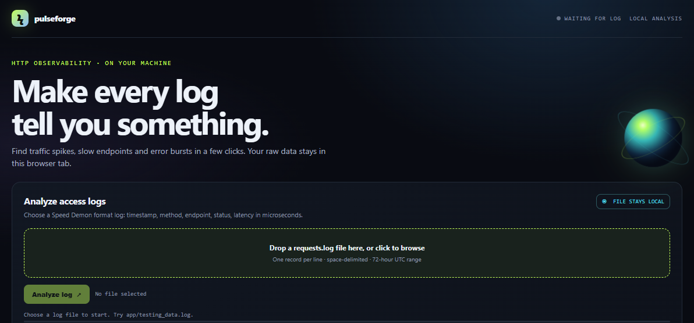

# speedDemon · PulseForge

**Fast, private HTTP log analysis.**
PulseForge turns structured access logs into hourly endpoint summaries with exact nearest-rank p50 / p95 / p99 latency, 5xx counts and error rates.



> Your log file is processed locally in the browser. It is never uploaded.

---

## Features

- **Exact percentiles:** nearest-rank p50, p95 and p99 per endpoint per hour
- **Error tracking:** 5xx counts and error rates (499 responses are not counted as 5xx)
- **Responsive UI:** analysis runs in a Web Worker, so the page never freezes
- **Dashboard:** hourly traffic and 5xx rate charts, with notable groups flagged
- **Explore easily:** endpoint search, hour filter, error-only filter, sorting and pagination
- **Export:** byte-stable `summary.txt` and filtered CSV
- **Private by design:** no server, no upload, no hosted analyzer

## Two ways to use it

| Mode | Description | Location |
|------|-------------|----------|
| Local web workbench | Browser app to analyze a log file, inspect results and download `summary.txt` | [`app/index.html`](app/index.html) |
| Competition runner | Zero-dependency Rust implementation for Speed Demon 2026 Track A | [`track-a/`](track-a/) |

## Quick start (web workbench)

1. Open `app/index.html` in a current browser.
2. Choose or drop in your log file.
3. Explore the dashboard; filter and sort the results.
4. Download `summary.txt` or the filtered CSV.

No install and no build step required.

## Input format

An ASCII, space-delimited request log with these fields:

| Field | Description |
|-------|-------------|
| timestamp | Request time |
| method | HTTP method |
| endpoint | Request path |
| status | HTTP status code |
| latency | Latency in microseconds |

> Note: the analyzer expects the Speed Demon Track A log shape and a fixed 72-hour date span. For other formats or date ranges, adapt the timestamp and parser rules before use.

## Output

For each hour and endpoint group:

- Request count
- p50 / p95 / p99 latency (exact nearest-rank)
- 5xx count
- Error rate

## Competition entry (Speed Demon 2026, Track A)

The Rust runner reads `/data/requests.log` and writes the byte-stable `/out/summary.txt`.

- Offline Docker build and execution contract: [`track-a/README.md`](track-a/README.md)
- Optimization evidence: [`track-a/PERF.md`](track-a/PERF.md). It records only real measurements; board results are added as they arrive.

## Project structure

```text
SpeedDemon/
├── app/
│   └── index.html        # Local web workbench
├── track-a/
│   ├── README.md         # Docker build and run contract
│   ├── PERF.md           # Optimization evidence
│   └── src/              # Rust competition runner
├── docs/
│   └── Screenshot 2026-11-02 183439.png
├── LICENSE
└── README.md
```

## Why it is useful

Raw logs are hard to scan when an incident spans many endpoints and hours. PulseForge gives engineers a compact, sortable view of traffic volume, tail latency and server-error rates, without sending production data to a hosted analyzer.

## License

MIT. See [`LICENSE`](LICENSE).
